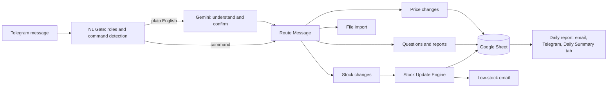

# Telegram Inventory Bot

A shop-inventory assistant that runs entirely in a Telegram chat. Staff record sales and deliveries by typing normal messages, and the owner gets live stock answers, price control, daily sales and profit, low-stock alerts and an evening report by email and Telegram. All records live in the shop's own Google Sheet.

Built with **n8n**, **Google Sheets**, **Telegram**, **Gmail** and **Google Gemini** for natural-language understanding.

> Built for small shops that cannot justify a till, scanners and software licences. It is not a point-of-sale replacement. It records what your team tells it, keeps an audit trail of every change, and checks the stock with counts and alerts.

## What it does

- **Understands plain English.** "sold 2 breads to John" or "how much milk do we have?" works. Short commands such as `remove 5 milk` work too. Every change is read back and applied only after the user replies **YES**.
- **Tracks stock and value.** Stock in is valued at cost and stock out at selling price. The bot replies with a receipt showing the total.
- **Daily sales and profit.** Ask `sales today`, `profit yesterday`, `sales week` or `sales month`. Profit is the selling price minus the cost recorded at the time of sale.
- **Evening report.** Every day at a set time the manager receives sales, cost of goods, gross profit and margin, a comparison with yesterday, top products, stock bought in, and every product running low. It arrives by email (with a 7-day chart) and in Telegram, and one row per day is saved to a `Daily Summary` sheet tab.
- **Low-stock alerts.** An email is sent when a product reaches its reorder level, listing every product that is currently low.
- **Roles.** Managers can do everything. Staff can only record sales (`remove`) and ask questions.
- **Audit trail.** Every change is logged with who made it, their chat ID, the time and the result.
- **Risk alerts and stock counts.** Unusual activity is flagged to the manager, and a stock count compares physical counts with the system.
- **Price control.** The manager can change cost and selling prices, and add new products in plain English.
- **Bulk import.** Send a CSV or Excel file to update many products at once. A dry run checks it first without changing anything.
- **Barcode support (optional).** A scanned barcode records a sale. Barcodes are stored in a `Barcode` column of the Inventory sheet.

## How it works

The project is made of two n8n workflows, plus the evening report that runs on a schedule:

| Part | Role |
| --- | --- |
| **Bulk Inventory Import (Telegram)** | The main bot: reads messages, checks permissions, understands requests, prices changes, answers questions and sends the daily report |
| **Inventory Stock Update Engine** | A sub-workflow that validates each change, writes it to the sheet, verifies it by reading it back, logs it and sends low-stock emails |
| **Daily report (scheduled)** | Calculates the day's sales and profit, emails and messages the manager and saves the daily row |

## Google Sheet layout

Create one spreadsheet with these tabs.

| Tab | Columns |
| --- | --- |
| **Inventory** | Product ID, Item name, Quantity, Unit, Reorder level, Cost price, Selling price, Low stock alerted, Updated at, Barcode (optional) |
| **Inventory Change Log** | Timestamp, Request ID, Product ID, Item name, Action, Previous quantity, Change quantity, New quantity, Status, Message, Request source, Name, ChatID |
| **Value Ledger** | Timestamp, Request ID, Product ID, Item name, Action, Quantity, Unit price, Price basis, Total value, Direction, Source, Name, ChatID, Date, Unit cost, Profit |
| **Daily Summary** | Date, Sales, Cost of goods, Profit, Margin %, Items sold, Sales lines, Stock received, Stock corrections, Low stock count, Low stock products |

Format the **Barcode** column as plain text so Sheets does not turn the codes into scientific notation.

## Setup

1. **Telegram.** Create a bot with BotFather and add its token as a Telegram credential in n8n.
2. **Google.** Add Google Sheets and Gmail OAuth credentials in n8n.
3. **Gemini.** Add a Google Gemini (PaLM) API key as a credential for the **Ask Gemini** node.
4. **Sheet.** Create the spreadsheet above and put its ID in the Google Sheets nodes.
5. **Import the workflows** from the `workflows/` folder: the stock update engine first, then the main bot. In the main bot's **Call Engine** node, select your imported engine. Import the daily report workflow too if it is separate in your version.
6. **People and roles.** In the **NL Gate** node, list each person's Telegram chat ID with their name and role (`manager` or `staff`). Anyone not listed is refused.
7. **Email and time zone.** Set the manager's email in the Gmail nodes and the time zone in the workflow settings, for example `Africa/Nairobi`, so each day ends at the right hour.
8. **Activate** every workflow. The YES/NO confirmation and the scheduled report only work when workflows are active.

The `_DEMO` workflow files contain no real IDs, emails or credentials. Replace the `YOUR_...` placeholders with your own.

## Commands

| Type | Who | Example |
| --- | --- | --- |
| Record a sale | Everyone | `remove 2 bread` or `sold 2 bread, 4 milk` |
| Add or set stock | Manager | `add 20 bread`, `set 30 bread` |
| Ask about stock | Everyone | `stock bread`, `low stock`, `list` |
| Sales and profit | Manager | `sales today`, `profit yesterday`, `sales week` |
| Change a price | Manager | `price bread cost 45 sell 60` |
| New product | Manager | `create Water 100 bottle 20 cost 40 sell 55` |
| Stock count | Manager | `count apples 48, milk 40` |
| Test first | Everyone | `dry run remove 5 milk` |
| Barcode | Everyone | scan a code, or `6161100000012 x3` |

## Security

- Only chat IDs listed in the NL Gate node can use the bot, and a role limits what each can do.
- Staff cannot add stock, change prices, create products, import files, run counts or see profit.
- Tokens and API keys stay in the n8n credential store and are never stored in the workflow files.
- Every write is verified by reading the sheet back, and every attempt is logged with name, chat ID and time.
- Message text is sent to Gemini to be understood, and Telegram bot chats are not end-to-end encrypted. Do not put customer personal data in chats.
- Keep n8n behind HTTPS with a strong login, and share the Google Sheet only with the people who need it.

## Known limitations

- It only knows about sales that staff report. A scanning till records every sale automatically and this does not.
- Every `remove` counts as a sale. Damaged or lost stock should be corrected with a stock count.
- Sales recorded before unit costs were saved use the product's current cost price, so older profit figures are approximate.
- Scanner support needs a Bluetooth or USB scanner that types the code like a keyboard.
- The YES/NO confirmation is stored in n8n's workflow static data, which only persists while the workflow is active.

## Roadmap

- Read barcodes from a photo with Gemini
- M-Pesa payment matching
- Voice notes and photos of delivery notes
- Multi-shop support
- Weekly summary to the owner

## Tech stack

n8n · Telegram Bot API · Google Sheets · Gmail · Google Gemini · JavaScript (n8n Code nodes)

## Author

Built by Obiero, a Data Science student in Kenya. Questions and ideas are welcome through GitHub issues.
