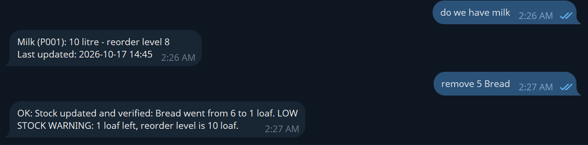
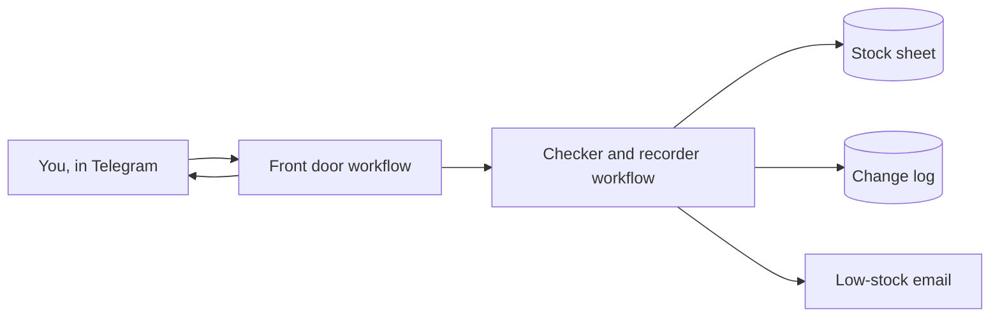
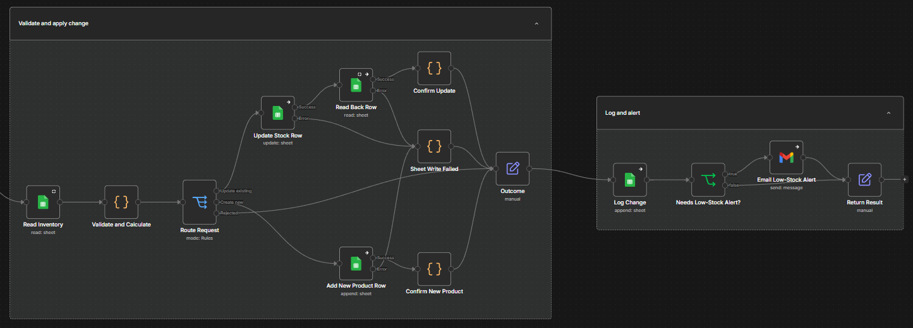

# Inventory Bot

**Check and update your stock from your phone, using Telegram.**

---

## The problem

- Stock records are out of date, so you find out something ran out when a customer asks for it.
- Updating a spreadsheet is a chore, so it gets left until later.
- When numbers don't match, nobody knows who changed what.

## What it does

Send the bot a short message. It checks it, updates your stock sheet, and replies.

| You send | You get |
|---|---|
| `add 20 bread` | Stock updated, with the new total |
| `remove 5 milk` | Stock updated, with a warning if it is now low |
| `low stock` | A list of everything that needs ordering |
| `stock bread` | How much bread you have right now |
| A spreadsheet file (for a whole delivery) | Every row checked, with a clear report of what went in and what didn't |
| `dry run` before any change | A preview of what would happen, with nothing changed |



*A real conversation: a question about milk, then a change that leaves bread low on stock.*

## Why it helps

- **Know what you have, any time.** Ask from your phone.
- **Don't run out.** The bot warns you when a product reaches its reorder level.
- **Fewer mistakes.** Wrong names, wrong units and removing more than you have are all caught and explained.
- **A record of every change.** Good or bad, every attempt is written to a log.
- **Only the right people.** Only approved Telegram accounts can change stock.

## How it works



Two workflows built in [n8n](https://n8n.io). The front door reads your messages and files. The checker and recorder is the only part that changes stock.

**Front door**


**Checker and recorder**



## Good to know

- It records what people tell it. Keep doing a real stock count now and then.
- It tracks quantities only, not prices.
- It does not connect to a till and does not order from suppliers.
- There is no undo button. Fix a mistake by recording a correction. The log keeps both.

## Try it

1. Ask your administrator to follow [docs/SETUP.md](docs/SETUP.md).
2. Send `help` to the bot.
3. Read [docs/HOW_TO_USE.md](docs/HOW_TO_USE.md) (one page).
4. Practise with the files in [samples/](samples).

## What is in this folder

```
README.md        This page
docs/            How to use it, and how to set it up
workflows/       The two n8n workflows to import
samples/         Practice files
templates/       Column headings for the two Google Sheets
```
